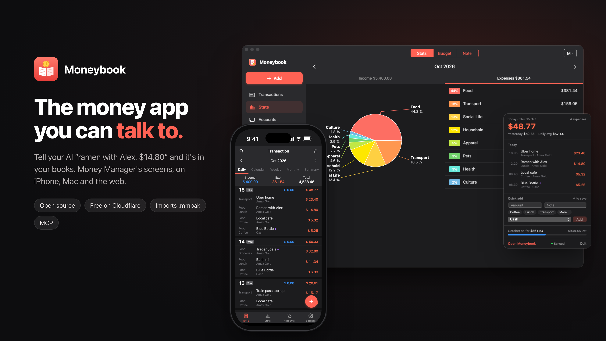
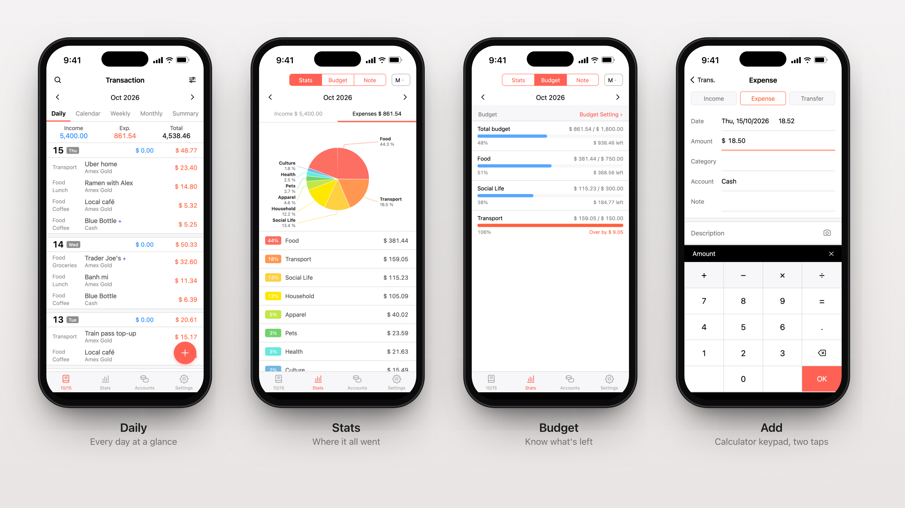
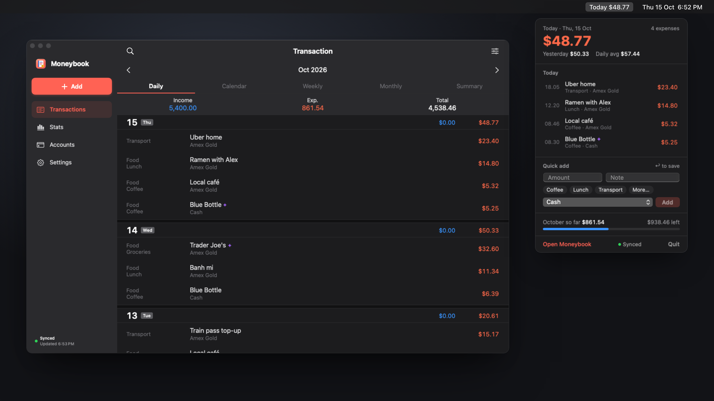

# Moneybook

**The money app you can talk to.** Moneybook is an open-source take on Realbyte's Money Manager. It has the
same screens on iPhone, Mac and the web, and an MCP server, so your AI can log expenses for you.
Say *"ramen with Alex, $14.80 on the Amex"* and it's in your books.

[](https://deploy.workers.cloudflare.com/?url=https://github.com/rizaardiyanto1412/moneybook)



- **Talk to it.** Claude (or any MCP client) can add, edit, search and summarise your transactions. It can
  also read a receipt photo. Rows the AI adds get a small ✦.
- **The screens you know.** Daily, Calendar, Weekly, Monthly and Summary views, Stats with the labelled pie,
  Budgets, Notes, Accounts with running balances, and the entry form with the calculator keypad.
- **Everywhere.**
  - A web app you can add to your iPhone home screen.
  - A native Mac app with today's spending in the menu bar.
  - A native iPhone app.
- **Bring your history.** Import a Money Manager `.mmbak` backup and every transaction comes along.
- **Yours.** It runs on your own free Cloudflare account, or on any server with Docker. Your data stays in
  your own database.





## Get started

You need somewhere to run the server. A free Cloudflare account is enough. The server hosts the web app, the
API that the Mac and iPhone apps use, and the MCP endpoint for your AI.

### 1. Deploy the server

**Option A: one click.** Press **Deploy to Cloudflare** above. Cloudflare copies this repo to your GitHub,
creates the database and deploys it.
- It asks for one secret, `API_TOKEN`. This is your master key, so make it long and random (for example the
  output of `openssl rand -hex 24`) and save it in your password manager.
- When it finishes, you get an address like `https://moneybook.<you>.workers.dev`.

**Option B: from your computer.** You need Node 22 or later and a Cloudflare account.

```sh
git clone https://github.com/rizaardiyanto1412/moneybook.git
cd moneybook/server
npm install
npx wrangler login                 # opens Cloudflare in your browser
./scripts/deploy-cloudflare.sh     # creates the database, makes a token, deploys
```

The script prints your app address, your API token and the ready-made commands for connecting your AI. It
also saves the token in `server/.deploy-token`, which git ignores. Run the script again to deploy updates.

**Option C: your own server (Docker).** You need a VPS with Docker.

```sh
git clone https://github.com/rizaardiyanto1412/moneybook.git && cd moneybook
echo "API_TOKEN=$(openssl rand -hex 24)" > .env    # your token is in .env
docker compose up -d                               # http://your-server:8787, put it behind HTTPS (e.g. Caddy)
```

### 2. Sign in and set a password

1. Open your app address in a browser.
2. Sign in with your **API token**. Then go to **Settings → Password** and set an email and password. From now
   on you sign in with those on every device, and you can sign them all out at once.
3. On iPhone, open the address in Safari and choose **Share → Add to Home Screen**. It then works like an app.
4. Coming from Money Manager? Export a backup there (**More → Backup → Export to a file**). Then in Moneybook
   go to **Settings → Backup → Import from Money Manager** and pick the `.mmbak` file. See
   [Import from Money Manager](#import-from-money-manager) below.

### 3. Connect your AI

Open **Settings → AI Assistant**. It shows your MCP address and your token (hidden until you enter your
password), each with a copy button.

- **Claude Code:** copy the command shown there, or run
  `claude mcp add --transport http moneybook https://<your-app>/mcp --header "Authorization: Bearer <token>"`
- **Claude Desktop, claude.ai or the Claude iPhone app:** go to **Settings → Connectors → Add custom connector**
  and use the URL `https://<your-app>/mcp/<token>`.
- **Anything else:** any MCP client that supports Streamable HTTP works the same way.

Then just talk: *"Log $8.50 coffee at Blue Bottle on my card"*, *"How much did I spend on food this month?"*,
or send a receipt photo and say *"add this"*.

### 4. Optional: the Mac and iPhone apps

- **Mac** (macOS 15+):
  1. Download `Moneybook-mac.zip` from the [latest Mac release](https://github.com/rizaardiyanto1412/moneybook/releases)
     and unzip it.
  2. Move **Moneybook** to Applications and open it. macOS will refuse the first time, because the app isn't
     notarized. Go to **System Settings → Privacy & Security** and press **Open Anyway**.
  3. In Moneybook's Settings, enter your app address and API token.

  To build it yourself, see [mac/README.md](mac/README.md).
- **iPhone:** the home-screen web app from step 2 covers everything. If you'd rather have the native app,
  build it with Xcode by following [ios/README.md](ios/README.md).

### Where do I find my token?

| You deployed with | Your token is |
|---|---|
| The Deploy to Cloudflare button | What you typed for `API_TOKEN`. To change it: Cloudflare dashboard → Workers → moneybook → Settings → Variables and Secrets |
| `deploy-cloudflare.sh` | Printed at the end, and saved in `server/.deploy-token` |
| Docker | In `.env` |
| Any of them, once you're signed in | **Settings → AI Assistant → Show** (it asks for your password) |

The token is a master key: it opens all your data and connects your AI. Keep it out of git (the
`.gitignore` already excludes `.deploy-token`, `.dev.vars` and `.env`), and don't paste it into public places.
If it leaks, set a new one:

- **Cloudflare:** run `npx wrangler secret put API_TOKEN -c ../wrangler.toml` from `server/`, or change it in
  the dashboard.
- **Docker:** edit `.env` and restart.

Then update your AI connector.

## Import from Money Manager

1. In Money Manager, go to **More → Backup → Export to a file**.
2. In Moneybook, go to **Settings → Backup → Import from Money Manager** and pick the `.mmbak` file.

Moneybook reads the file in the browser and shows you a preview (counts and currency) before uploading
anything. Then choose *Replace everything* or *Add to existing*.

Or from the command line:

```sh
cd server
npx tsx scripts/import-mmbak.ts "MM(...).mmbak" --dry-run                                  # preview counts
npx tsx scripts/import-mmbak.ts "MM(...).mmbak" --url https://<host> --token <token> --replace
```

- `--replace` swaps out the starter accounts and categories.
- Re-running is safe, because rows keep their Money Manager ids.
- Android backups follow the reverse-engineered schema exactly. iPhone backups are mapped best-effort: if a
  column is missing, the importer says so, and `--inspect` prints the backup's tables.
- Photos aren't stored inside `.mmbak` files, so they don't come across.

## How it's built

```
server/   API + MCP server (TypeScript, Hono). Cloudflare Workers + D1, or Node + SQLite anywhere.
web/      The web app (PWA, no build step), served by the server.
mac/      Native macOS app (SwiftUI). Builds with the Command Line Tools, no Xcode needed.
ios/      Native iPhone app (SwiftUI, XcodeGen). Shares mac/'s MoneybookCore and MoneybookClient.
docs/     API.md (REST API reference), images.
```

**The database is SQLite in both setups.**
- On Cloudflare it's [D1](https://developers.cloudflare.com/d1/), Cloudflare's hosted SQLite. The free plan
  is plenty for one person.
- On your own server it's a single SQLite file (Node's built-in `node:sqlite`) in the data volume.

The tables are created on the first request, so there are no migrations to run. Receipt photos are stored in
the database, or optionally in R2 (see `wrangler.toml`). The REST API is documented in [docs/API.md](docs/API.md).

## Local development

```sh
cd server && npm install
API_TOKEN=dev npm start      # http://localhost:8787, sign in with the token "dev"
npm test
```

---

Moneybook is an independent project. It isn't affiliated with or endorsed by Realbyte, the makers of Money Manager.
